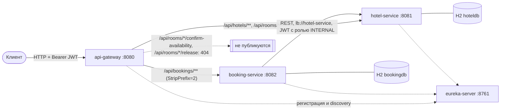
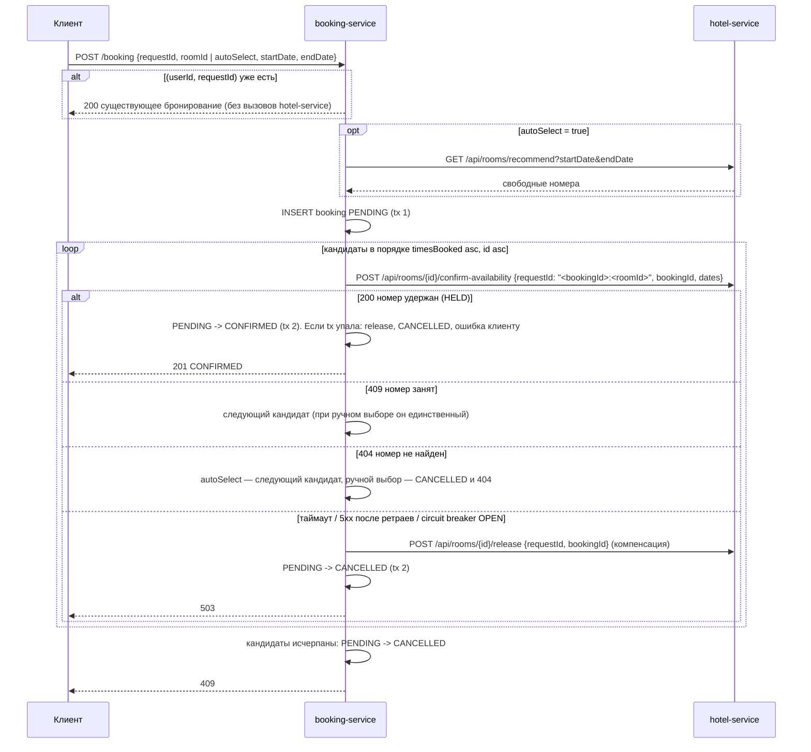

# Hotel Booking System

Микросервисная система бронирования номеров в отелях на Spring Boot 3.5.7 и Spring Cloud 2025.0.0.
Клиент работает через API Gateway. Бронирование создаётся в `booking-service` и подтверждается в `hotel-service`
по схеме саги с компенсацией; каждый сервис хранит данные в собственной in-memory H2.

## Архитектура

| Модуль | Порт | Назначение |
|---|---|---|
| [`eureka-server`](eureka-server/README.md) | 8761 | Service registry (Netflix Eureka) |
| [`api-gateway`](api-gateway/README.md) | 8080 | Единая точка входа: маршрутизация, проверка JWT, `X-Trace-Id` |
| [`hotel-service`](hotel-service/README.md) | 8081 | Отели, номера, удержание номеров на даты, статистика загрузки |
| [`booking-service`](booking-service/README.md) | 8082 | Пользователи, JWT, бронирования, оркестратор саги |
| [`common`](common/README.md) | — | Библиотека: формат ошибок, обработчик исключений, настройка resource server |



`StripPrefix=2`: `/api/bookings/booking/5` → `/booking/5`. Маршруты и фильтры — в [api-gateway/README.md](api-gateway/README.md).

### Сага бронирования

`POST /api/bookings/booking` выполняет `BookingSagaOrchestrator`. Каждый переход статуса коммитится отдельной
транзакцией (`BookingStateService`), вызовы `hotel-service` идут вне транзакций БД. Решения: [docs/adr](docs/adr/README.md).



## Требования

- JDK 17+ (`java.version=17`; проверено на OpenJDK 21).
- Apache Maven 3.9+.

Все библиотеки (Spring Boot, Spring Cloud, Resilience4j, springdoc, MapStruct, Lombok, H2, WireMock) Maven скачивает
из Maven Central при первой сборке. Внешние СУБД, брокеры и Docker не используются.

## Сборка и запуск

```bash
mvn clean install              # все модули, тесты и spotless:check
mvn clean install -DskipTests  # без тестов
```

`install` обязателен: `mvn -pl <module> spring-boot:run` берёт `common` из локального репозитория Maven.

Запуск — каждый сервис в отдельном терминале, в этом порядке:

```bash
mvn -pl eureka-server spring-boot:run
mvn -pl hotel-service spring-boot:run
mvn -pl booking-service spring-boot:run
mvn -pl api-gateway spring-boot:run
```

Или из jar в том же порядке: `java -jar <module>/target/<module>-1.0.0.jar`.

Готовность: `curl http://localhost:8080/actuator/health` → `{"status":"UP"}`; в дашборде Eureka (http://localhost:8761)
есть `API-GATEWAY`, `BOOKING-SERVICE`, `HOTEL-SERVICE`. После `UP` всех сервисов `booking-service` видит `hotel-service`
примерно через 5 секунд (интервалы Eureka и кэш load balancer — 5 с); запросы до этого получают `503`. Если за это время
накопились ошибки, circuit breaker `hotelService` размыкается на 10 секунд — повторите запрос позже с новым `requestId`.

Остановка — `Ctrl+C`. Данные в памяти, пересоздаются при каждом запуске. `hotel-service` и `booking-service`
перезапускайте вместе: бронирования и удержания согласованы между двумя базами.

## Тестовые данные

Создаются классами `DataSeeder` при старте (`app.seed.enabled=false` отключает). Даты отсчитываются от текущего дня T;
`endDate` — день выезда, в период не входит.

Пользователи (`booking-service`, пароли — BCrypt-хэш):

| id | username | password | role |
|---|---|---|---|
| 1 | `admin` | `admin123` | ADMIN |
| 2 | `user` | `user123` | USER |
| 3 | `alice` | `alice123` | USER |

Отели и номера (`hotel-service`):

| Отель (id) | Номера: id / number / available / timesBooked |
|---|---|
| 1 Grand Plaza, Moscow, Tverskaya st. 1 | 1/101/да/5, 2/102/да/2, 3/103/да/0, 4/104/нет/1 |
| 2 Sea Breeze, Sochi, Kurortny ave. 12 | 5/201/да/3, 6/202/да/0, 7/203/да/7 |
| 3 Neva View, Saint Petersburg, Nevsky ave. 30 | 8/301/да/1, 9/302/да/4 |

Бронирования и согласованные с ними удержания:

| booking id | user | room | период | статус | удержание в hotel-service |
|---|---|---|---|---|---|
| 1 | user | 1 | [T+1, T+4) | CONFIRMED | HELD, requestId `1:1` |
| 2 | user | 5 | [T+2, T+5) | CONFIRMED | HELD, requestId `2:5` |
| 3 | alice | 9 | [T+10, T+12) | CONFIRMED | HELD, requestId `3:9` |
| 4 | user | 2 | [T+1, T+3) | CANCELLED | — |

## Эндпоинты

Пути даны относительно gateway `http://localhost:8080`. Кроме регистрации и входа, все запросы требуют
`Authorization: Bearer <accessToken>`. Общие ответы: `401` — нет токена, токен истёк, подпись или issuer неверны
(для бронирований — также нет числового claim `uid`); `403` — недостаточно прав; `400` — ошибка валидации.
`GET /actuator/health` публичен на всех сервисах; `GET /actuator/info` — на всех, кроме gateway (там нужен токен).
Пагинация: `page` (с 0), `size` (по умолчанию 10, максимум 100), `sort` (`поле,asc|desc`); ответ
`{content, page, size, totalElements, totalPages}`.

### Аутентификация и пользователи (booking-service)

| Метод | Путь | Роль | Тело / параметры | Ответ |
|---|---|---|---|---|
| POST | `/api/bookings/user/register` | публичный | `{username (3..50), password (6..72 символов и не более 72 байт UTF-8 — предел BCrypt)}` | `201` TokenResponse с ролью USER; `409` имя занято |
| POST | `/api/bookings/user/auth` | публичный | `{username, password}` | `200` TokenResponse; `401` неверные учётные данные |
| POST | `/api/bookings/user` | ADMIN | `{username, password (6..72, ≤ 72 байт), role: USER\|ADMIN}` | `201` UserResponse; `409` имя занято |
| GET | `/api/bookings/user` | ADMIN | пагинация, сортировка по умолчанию `id` | `200` страница UserResponse |
| GET | `/api/bookings/user/{id}` | ADMIN | — | `200`; `404` |
| PATCH | `/api/bookings/user/{id}` | ADMIN | `{username?, password?, role?}` — меняются только переданные поля | `200`; `404`; `409` имя занято |
| DELETE | `/api/bookings/user/{id}` | ADMIN | — | `204` (удаляются и отменённые брони пользователя); `404`; `409` есть брони PENDING/CONFIRMED |

TokenResponse: `{accessToken, tokenType: "Bearer", expiresIn: 3600, username, role}`. UserResponse: `{id, username, role, createdAt}`.

### Бронирования (booking-service)

| Метод | Путь | Роль | Тело / параметры | Ответ |
|---|---|---|---|---|
| POST | `/api/bookings/booking` | USER, ADMIN | `{requestId, roomId?, autoSelect, startDate, endDate}` | `201` новое бронирование CONFIRMED; `200` повтор с тем же `requestId` и теми же параметрами; `404` номер не найден (только при ручном выборе; при `autoSelect` номер пропускается); `409` номер занят / нет свободных номеров / `requestId` уже использован с другими датами или (при `autoSelect=false`) другим `roomId`; `503` hotel-service недоступен |
| GET | `/api/bookings/bookings` | USER, ADMIN | пагинация, по умолчанию `createdAt,desc` | `200` страница собственных бронирований |
| GET | `/api/bookings/booking/{id}` | USER, ADMIN | — | `200`; `403` чужое бронирование (ADMIN видит любое); `404` |
| DELETE | `/api/bookings/booking/{id}` | USER, ADMIN | — | `200` бронирование CANCELLED (уже отменённое, в том числе параллельной отменой, возвращается без изменений); `403`; `404`; `409` PENDING у владельца (ADMIN отменяет и PENDING: release, затем CANCELLED); `503` hotel-service недоступен, бронирование остаётся CONFIRMED |
| GET | `/api/bookings/booking/recommendations` | USER, ADMIN | `startDate`, `endDate`, `hotelId?` | `200` свободные номера по `timesBooked` asc, `id` asc; `503` |

`GET /booking/recommendations` берёт список из `GET /api/rooms/recommend` hotel-service и сортирует его в booking-service
(`RoomRanking`, `timesBooked asc, id asc`); тем же порядком пользуется автоподбор в `POST /booking`.

Валидация CreateBookingRequest: `requestId` обязателен, до 64 символов; `startDate` не в прошлом; `endDate` строго позже
`startDate`; `roomId` обязателен при `autoSelect=false` и игнорируется при `autoSelect=true`.

BookingResponse: `{id, userId, roomId, startDate, endDate, status: PENDING|CONFIRMED|CANCELLED, requestId, createdAt}`.
Переходы статуса проверяет сущность `Booking`: `PENDING → CONFIRMED | CANCELLED`, `CONFIRMED → CANCELLED`; иной переход — `409`.

### Отели (hotel-service)

| Метод | Путь | Роль | Тело / параметры | Ответ |
|---|---|---|---|---|
| POST | `/api/hotels` | ADMIN | `{name, address}` (до 255 символов) | `201` HotelResponse |
| GET | `/api/hotels` | USER, ADMIN | `name?`, `address?` (подстрока без учёта регистра), пагинация, сортировка по умолчанию `id` | `200` страница HotelResponse; `400` неизвестное поле сортировки |
| GET | `/api/hotels/{id}` | USER, ADMIN | — | `200`; `404` |
| PUT | `/api/hotels/{id}` | ADMIN | `{name, address}` | `200`; `404` |
| DELETE | `/api/hotels/{id}` | ADMIN | — | `204` (удаляет номера и снятые удержания); `404`; `409` есть удержания HELD |
| GET | `/api/hotels/stats` | ADMIN | `from`, `to` (`to` > `from`, не включается) | `200` загрузка отелей, сортировка `occupancyRate` desc, `hotelId` asc |

HotelResponse: `{id, name, address}`. Элемент статистики: `{hotelId, name, totalRooms, availableRooms, totalTimesBooked,
bookedNights, occupancyRate}`, где `occupancyRate = bookedNights / (totalRooms × ночей периода)`, округление до 2 знаков.

### Номера (hotel-service)

| Метод | Путь | Роль | Тело / параметры | Ответ |
|---|---|---|---|---|
| POST | `/api/rooms` | ADMIN | `{hotelId, number (до 32), available? (по умолчанию true)}` | `201` RoomResponse; `404` отель не найден; `409` такой `number` уже есть в отеле |
| GET | `/api/rooms` | USER, ADMIN, INTERNAL | `startDate`, `endDate`, `hotelId?` | `200` свободные номера: `available=true` и без пересекающихся удержаний HELD |
| GET | `/api/rooms/recommend` | USER, ADMIN, INTERNAL | те же | `200` те же номера, сортировка `timesBooked` asc, `id` asc |
| GET | `/api/rooms/{id}` | USER, ADMIN | — | `200`; `404` |
| PUT | `/api/rooms/{id}` | ADMIN | `{number, available}` | `200`; `404`; `409` `number` занят другим номером отеля |
| DELETE | `/api/rooms/{id}` | ADMIN | — | `204`; `404`; `409` есть удержания HELD |
| GET | `/api/rooms/stats` | ADMIN | `from`, `to`, `hotelId?`, `sortBy=timesBooked\|occupancyRate\|id` (по умолчанию `timesBooked`), `direction=asc\|desc` (по умолчанию `asc`) | `200` загрузка номеров |

RoomResponse: `{id, hotelId, number, available, timesBooked}`. Элемент статистики номеров:
`{roomId, hotelId, number, available, timesBooked, activeReservations, bookedNights, occupancyRate}`;
`bookedNights` — ночи удержаний HELD, попадающие в `[from, to)`.

### Внутренние эндпоинты (не публикуются через gateway)

Доступны только напрямую на `hotel-service:8081` с JWT роли `INTERNAL`, который выпускает `booking-service`.
Через gateway — `404` с телом ошибки в [едином формате](#формат-ошибок).

| Метод | Путь | Тело | Ответ |
|---|---|---|---|
| POST | `/api/rooms/{id}/confirm-availability` | `{requestId (до 100), bookingId, startDate, endDate}` | `200` `{reservationId, requestId, bookingId, roomId, startDate, endDate, status}`; `404`; `409` номер недоступен, даты заняты, `requestId` уже использован для другого бронирования, номера или дат либо его удержание уже снято |
| POST | `/api/rooms/{id}/release` | `{requestId, bookingId}` | `200` `{bookingId, roomId, releasedCount}`; повтор — `releasedCount: 0`. Если удержания нет и `requestId` не встречался, сохраняется запись-«надгробие» RELEASED с этим `requestId`: опоздавший `confirm-availability` с тем же `requestId` получит `409` |

## Пример сценария (curl)

Дождитесь регистрации сервисов в Eureka. Пример для bash/zsh; даты в будущем, формат `YYYY-MM-DD`.

```bash
GW=http://localhost:8080
START=2030-01-10
END=2030-01-13
JSON='Content-Type: application/json'

# 1. Вход и токен
TOKEN=$(curl -s -X POST $GW/api/bookings/user/auth -H "$JSON" \
  -d '{"username":"user","password":"user123"}' | sed -E 's/.*"accessToken":"([^"]+)".*/\1/')

# 2. Рекомендации: свободные номера, наименее загруженные первыми
curl -s "$GW/api/bookings/booking/recommendations?startDate=$START&endDate=$END" -H "Authorization: Bearer $TOKEN"
# [{"id":3,"hotelId":1,"number":"103","available":true,"timesBooked":0},{"id":6,...},...]

# 3. Бронирование с автоподбором -> 201
curl -s -i -X POST $GW/api/bookings/booking -H "Authorization: Bearer $TOKEN" -H "$JSON" \
  -d "{\"requestId\":\"demo-1\",\"autoSelect\":true,\"startDate\":\"$START\",\"endDate\":\"$END\"}"
# HTTP/1.1 201 Created
# X-Trace-Id: 6ae719a5fc70287bc85d0d4d3b006a5e
# {"id":5,"userId":2,"roomId":3,"startDate":"2030-01-10","endDate":"2030-01-13","status":"CONFIRMED","requestId":"demo-1",...}

# 4. Повтор с тем же requestId -> 200, то же бронирование, номер повторно не удерживается
curl -s -i -X POST $GW/api/bookings/booking -H "Authorization: Bearer $TOKEN" -H "$JSON" \
  -d "{\"requestId\":\"demo-1\",\"autoSelect\":true,\"startDate\":\"$START\",\"endDate\":\"$END\"}"

# 5. Конкретный номер на занятые даты -> 409
curl -s -i -X POST $GW/api/bookings/booking -H "Authorization: Bearer $TOKEN" -H "$JSON" \
  -d "{\"requestId\":\"demo-2\",\"roomId\":3,\"autoSelect\":false,\"startDate\":\"$START\",\"endDate\":\"$END\"}"

# 6. Свои бронирования, новые первыми
curl -s "$GW/api/bookings/bookings?page=0&size=10" -H "Authorization: Bearer $TOKEN"

# 7. Отмена бронирования из шага 3 -> 200, status CANCELLED, удержание снято
curl -s -X DELETE $GW/api/bookings/booking/5 -H "Authorization: Bearer $TOKEN"

# 8. Статистика загрузки (ADMIN)
ADMIN_TOKEN=$(curl -s -X POST $GW/api/bookings/user/auth -H "$JSON" \
  -d '{"username":"admin","password":"admin123"}' | sed -E 's/.*"accessToken":"([^"]+)".*/\1/')
curl -s "$GW/api/hotels/stats?from=$START&to=$END" -H "Authorization: Bearer $ADMIN_TOKEN"
curl -s "$GW/api/rooms/stats?from=$START&to=$END&sortBy=occupancyRate&direction=desc" -H "Authorization: Bearer $ADMIN_TOKEN"

# 9. Безопасность
curl -s -i $GW/api/hotels                                                             # 401 без токена
curl -s -i -X POST $GW/api/hotels -H "Authorization: Bearer $TOKEN" -H "$JSON" -d '{"name":"X","address":"Y"}'  # 403 для USER
curl -s -i -X POST $GW/api/rooms/1/confirm-availability -H "Authorization: Bearer $ADMIN_TOKEN"  # 404: внутренний эндпоинт

# 10. Регистрация нового пользователя -> 201 с токеном
curl -s -X POST $GW/api/bookings/user/register -H "$JSON" -d '{"username":"bob","password":"bob12345"}'
```

## Swagger UI и Eureka

Swagger UI открывается напрямую на порту сервиса (через gateway не публикуется): http://localhost:8081/swagger-ui.html,
http://localhost:8082/swagger-ui.html; OpenAPI JSON — `/v3/api-docs` там же. Для защищённых методов нажмите Authorize и
вставьте `accessToken` из `/user/auth`. Пути в Swagger booking-service — без префикса `/api/bookings`. Eureka: http://localhost:8761.

## Тесты

```bash
mvn verify                                  # все модули: тесты + spotless:check
mvn -pl booking-service -am verify          # один модуль вместе с common
mvn -pl booking-service -am test -Dtest=BookingSagaTest -Dsurefire.failIfNoSpecifiedTests=false
mvn spotless:apply                          # автоформатирование, если spotless:check упал
```

Тесты не требуют запущенных сервисов: Eureka и сидирование отключены, порты случайные, файловый лог выключен
(`logging.file.name: ""`), `hotel-service` для `booking-service` и бэкенды для gateway подменяются WireMock через
`spring.cloud.discovery.client.simple.instances.<service>[0].uri`. Сценарии по классам — в README модулей.

| Модуль | Тестов | Классы |
|---|---|---|
| [booking-service](booking-service/README.md#тесты) | 79 | `BookingSagaTest`, `BookingSagaCompensationTest`, `HotelCircuitBreakerTest`, `BookingCancelRaceTest`, `ErrorResponseTest`, `BookingTest`, `BookingControllerTest`, `UserControllerTest`, `AuthControllerTest` |
| [hotel-service](hotel-service/README.md#тесты) | 73 | `RoomAvailabilityControllerTest`, `ConfirmAvailabilityConcurrencyTest`, `HotelControllerTest`, `RoomControllerTest`, `OccupancyStatsControllerTest`, `OccupancyMathTest`, `DataSeederTest` |
| [api-gateway](api-gateway/README.md#тесты) | 17 | `ApiGatewayRoutingTest`, `ApiGatewayErrorHandlingTest` |
| [eureka-server](eureka-server/README.md#тесты) | 2 | `EurekaServerApplicationTest` |

## Формат ошибок

Все сервисы возвращают ошибки в одном JSON (`com.hotelbooking.common.error.ErrorResponse`; в gateway — класс той же
формы без `fieldErrors`). Пустые поля не сериализуются.

```json
{
  "timestamp": "2026-11-01T10:50:32.644156Z",
  "status": 400,
  "error": "Bad Request",
  "message": "Validation failed",
  "path": "/booking",
  "traceId": "6ae71978857d64e5a597a7a4e2bc6679",
  "fieldErrors": {
    "roomId": "is required when autoSelect is false",
    "endDate": "end date must be after start date"
  }
}
```

`path` — публичный путь запроса: при `StripPrefix` gateway передаёт `X-Forwarded-Prefix`, и сервис подставляет его перед
своим URI (`/api/bookings/booking`); при прямом обращении к сервису `path` равен внутреннему URI.

Обработчики: `GlobalExceptionHandler` из [`common`](common/README.md) в сервисах, `GatewayErrorWebExceptionHandler` и
обработчики Spring Security в [gateway](api-gateway/README.md). Детали отклонённых запросов пишутся в лог на WARN, наружу
уходят общие сообщения: `Malformed request body`, `Invalid value for parameter '<имя>'`, `fieldErrors.<поле>: Invalid value`,
`Invalid sort property '<поле>'`, `Resource not found`.

| Статус | Когда |
|---|---|
| 400 | Bean Validation, неверный JSON, неверный тип или отсутствие параметра, неизвестное поле сортировки |
| 401 | нет или невалидный JWT (в том числе без `exp`), в пользовательском токене нет числового `uid`; неверный логин или пароль |
| 403 | недостаточно прав, чужое бронирование |
| 404 | сущность не найдена; неизвестный путь; внутренний путь через gateway |
| 405 / 406 / 415 | неподдерживаемый метод / недопустимый `Accept` / неподдерживаемый `Content-Type` |
| 409 | конфликт бизнес-правил, нарушение уникальности, оптимистическая блокировка |
| 503 | `hotel-service` недоступен для booking-service (таймаут, 5xx после ретраев, circuit breaker OPEN, нет экземпляров в Eureka); в gateway — нет экземпляров целевого сервиса или отказ в соединении |
| 504 | gateway не получил ответ сервиса за `response-timeout` (35s) |
| 500 | непредвиденная ошибка (детали только в логе) |

## Логирование и трассировка

- Micrometer Tracing (Brave), `management.tracing.sampling.probability: 1.0`; контекст передаётся по HTTP, gateway →
  booking-service → hotel-service работают с одним `traceId`.
- Gateway логирует каждый запрос (`метод путь -> статус in N ms traceId=...`) и возвращает заголовок `X-Trace-Id`;
  тот же `traceId` — в поле `traceId` тела ошибки.
- `booking-service` и `hotel-service` кладут в MDC `bookingId` на время саги, отмены, confirm и release.
- Консоль: префикс `[имя-сервиса,traceId,spanId,bookingId]`. Файл: JSON в формате ECS, `logs/<spring.application.name>.log`
  относительно рабочего каталога (при `mvn -pl <module> spring-boot:run` — каталог модуля), `traceId`, `spanId`, `bookingId` —
  отдельные ключи:

```bash
grep '"bookingId":"5"' booking-service/logs/booking-service.log hotel-service/logs/hotel-service.log
grep '6ae719a5fc70287bc85d0d4d3b006a5e' */logs/*.log
```

## Конфигурация

Значения по умолчанию — в `src/main/resources/application.yml` каждого модуля; переопределяются переменными окружения
(relaxed binding Spring Boot).

| Переменная | Где | По умолчанию | Назначение |
|---|---|---|---|
| `JWT_SECRET` | api-gateway, hotel-service, booking-service | `hotel-booking-dev-secret-key-change-me-0123456789` | секрет HS256, не короче 32 символов, одинаковый во всех трёх сервисах |
| `EUREKA_URL` | api-gateway, hotel-service, booking-service | `http://localhost:8761/eureka` | адрес Eureka |
| `APP_SEED_ENABLED` | hotel-service, booking-service | `true` | создавать тестовые данные |

Секрет по умолчанию учебный и лежит в репозитории. Вне локальной машины задайте свой для всех трёх сервисов,
например `export JWT_SECRET=$(openssl rand -base64 48)` перед запуском.

| Свойство | Значение | Модуль |
|---|---|---|
| `app.jwt.ttl` | `PT1H` | booking-service (выпуск), hotel-service |
| `app.jwt.issuer` | `hotel-booking` | все, кроме eureka-server |
| `app.hotel-client.connect-timeout` / `read-timeout` | `2s` / `3s` | booking-service |
| `spring.cloud.gateway.server.webflux.httpclient.connect-timeout` / `response-timeout` | `2000` ms / `35s`; `response-timeout` больше худшего времени саги при `autoSelect` (≈ 30s, [ADR-0005](docs/adr/0005-resilience-hotel-client.md)) | api-gateway |
| `resilience4j.retry.configs.default` | 3 попытки, 300 ms, множитель 2; только `ResourceAccessException` и `HttpServerErrorException` | booking-service |
| `resilience4j.retry.instances.hotelService` / `hotelRelease` | `base-config: default`; `hotelService` — confirm и recommend, `hotelRelease` — release | booking-service |
| `resilience4j.circuitbreaker.instances.hotelService` | окно 10 вызовов, минимум 5, порог 50%, OPEN 10s → HALF_OPEN автоматически, 5 пробных вызовов; `record-exceptions`: `ResourceAccessException`, `HttpServerErrorException`, остальное (4xx, бизнес-409/404) — успех; на release не действует | booking-service |
| `eureka.instance.lease-renewal-interval-in-seconds` | `5` | hotel-service, booking-service, api-gateway |
| `eureka.client.registry-fetch-interval-seconds` / `spring.cloud.loadbalancer.cache.ttl` | `5` / `5s` | booking-service, api-gateway |
| `spring.data.web.pageable.max-page-size` | `100` | hotel-service, booking-service |
| `spring.web.locale` / `spring.web.locale-resolver` | `en` / `fixed`; сообщения Bean Validation не зависят от `Accept-Language` | hotel-service, booking-service |
| `logging.level.org.hibernate.engine.jdbc.spi.SqlExceptionHelper` | `OFF`; ожидаемое нарушение `uk_bookings_user_request` при параллельных дубликатах не пишется как ERROR ([ADR-0002](docs/adr/0002-idempotency-by-request-id.md)) | booking-service |

## Документация

[docs/database.md](docs/database.md) — схема БД обоих сервисов, индексы, ER-диаграммы; [docs/adr](docs/adr/README.md) —
архитектурные решения; README модулей — по ссылкам в таблице [Архитектура](#архитектура).
