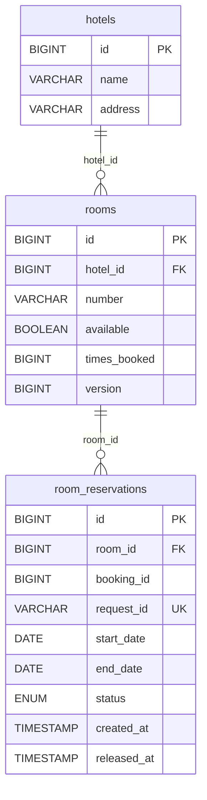
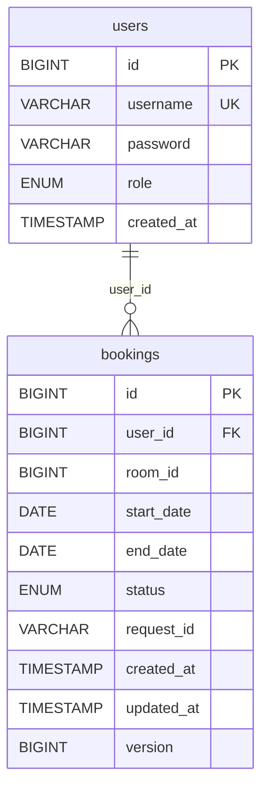
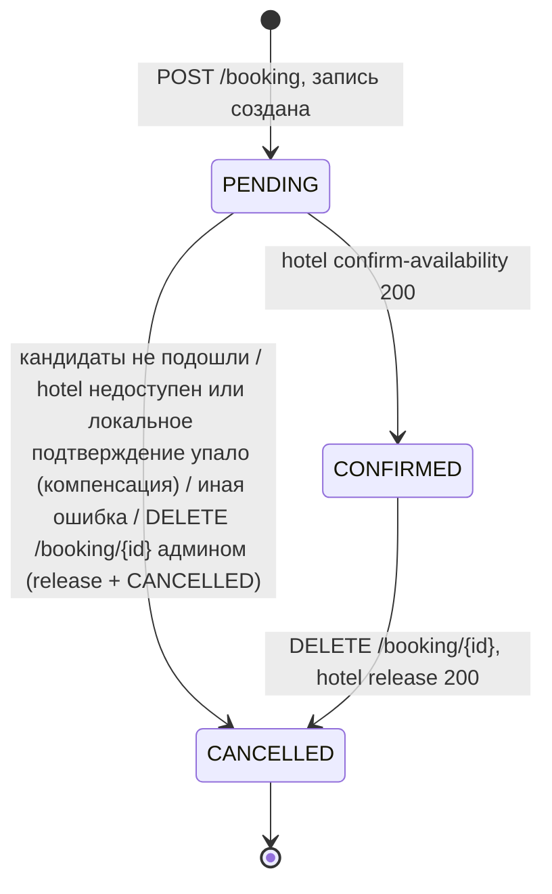

# Схема базы данных

Каждый сервис владеет своей базой: `hotel-service` — H2 `jdbc:h2:mem:hoteldb`, `booking-service` — H2
`jdbc:h2:mem:bookingdb`. Общих таблиц и межсервисных внешних ключей нет; связь логическая, по идентификаторам
(`bookings.room_id` → `rooms.id`, `room_reservations.booking_id` → `bookings.id`).

Схему генерирует Hibernate из JPA-сущностей (`spring.jpa.hibernate.ddl-auto: create-drop`); индексы и уникальные
ограничения объявлены в `@Table(indexes, uniqueConstraints)`. Ниже — DDL, который Hibernate создаёт в H2 (имена внешних
ключей генерируются и опущены).

Даты: `start_date` — день заезда (входит), `end_date` — день выезда (не входит). Периоды пересекаются, если
`a.start < b.end AND a.end > b.start`; заезд в день чужого выезда разрешён.

## hotel-service

### hotels — `Hotel`

| Колонка | Тип | Ограничения | Описание |
|---|---|---|---|
| `id` | BIGINT identity | PK | |
| `name` | VARCHAR(255) | NOT NULL | название |
| `address` | VARCHAR(255) | NOT NULL | адрес |

### rooms — `Room`

| Колонка | Тип | Ограничения | Описание |
|---|---|---|---|
| `id` | BIGINT identity | PK | |
| `hotel_id` | BIGINT | NOT NULL, FK → `hotels.id` | отель |
| `number` | VARCHAR(255) | NOT NULL | номер комнаты (API ограничивает 32 символами) |
| `available` | BOOLEAN | NOT NULL | доступен ли номер для бронирования вообще (выводится из оборота админом) |
| `times_booked` | BIGINT | NOT NULL | счётчик действующих удержаний: растёт при confirm, уменьшается при release (не ниже 0); основа рекомендаций |
| `version` | BIGINT | | оптимистическая блокировка (`@Version`) |

| Имя | Тип | Колонки | Назначение |
|---|---|---|---|
| `uk_rooms_hotel_number` | UNIQUE | `(hotel_id, number)` | номер уникален в пределах отеля; индекс для выборок номеров отеля |

### room_reservations — `RoomReservation`

| Колонка | Тип | Ограничения | Описание |
|---|---|---|---|
| `id` | BIGINT identity | PK | |
| `room_id` | BIGINT | NOT NULL, FK → `rooms.id` | номер |
| `booking_id` | BIGINT | NOT NULL | id бронирования в `booking-service` (логическая ссылка, без FK) |
| `request_id` | VARCHAR(100) | NOT NULL, UNIQUE | ключ идемпотентности шага саги `<bookingId>:<roomId>` (сид: `1:1`, `2:5`, `3:9`) |
| `start_date` | DATE | NOT NULL | заезд |
| `end_date` | DATE | NOT NULL | выезд (не входит) |
| `status` | ENUM('HELD','RELEASED') | NOT NULL | `HELD` — номер удержан; `RELEASED` — удержание снято (отмена или компенсация) либо «надгробие» release без удержания |
| `created_at` | TIMESTAMP(6) WITH TIME ZONE | NOT NULL | момент удержания |
| `released_at` | TIMESTAMP(6) WITH TIME ZONE | NULL | момент снятия |

| Имя | Тип | Колонки | Используется в |
|---|---|---|---|
| unique на `request_id` | UNIQUE | `request_id` | `findByRequestId` при повторе confirm, защита от двойного удержания |
| `idx_reservations_room_dates` | INDEX | `(room_id, start_date, end_date)` | проверка пересечения дат при confirm, поиск свободных номеров (`NOT EXISTS` по удержаниям HELD), статистика |
| `idx_reservations_booking` | INDEX | `booking_id` | release: выборка удержаний бронирования на номере |
| FK `room_id` | FK | `room_id` → `rooms.id` | |

Роль `room_reservations`: `rooms.available` описывает номер как ресурс, а не занятость на даты, поэтому hotel-service
хранит удержания сам и решает о занятости там же, где берёт блокировку строки `rooms` (ADR-0003).

- Поиск свободных номеров и рекомендации (`GET /api/rooms`, `/api/rooms/recommend`):
  `available = true AND NOT EXISTS (HELD-удержание, пересекающее период)`.
- Идемпотентность: повтор confirm с тем же `request_id` возвращает то же удержание (без второй записи и повторного
  `times_booked + 1`), только если совпадают номер, `booking_id`, даты и оно ещё `HELD`; иначе `409`.
- Release переводит удержания `HELD` бронирования на номере в `RELEASED` с `released_at`, не удаляя их; повтор возвращает
  `releasedCount: 0`. Если удержания нет и `request_id` не встречался, сохраняется запись `RELEASED` с этим `request_id`
  («надгробие», `start_date = end_date` = день release), и опоздавший confirm получает `409`.
- Статистика (`/api/hotels/stats`, `/api/rooms/stats`) считается по ночам удержаний `HELD`.
- Отель или номер с удержаниями `HELD` удалить нельзя (`409`); снятые удержания удаляются вместе с номером.

## booking-service

### users — `User`

| Колонка | Тип | Ограничения | Описание |
|---|---|---|---|
| `id` | BIGINT identity | PK | попадает в JWT как claim `uid` |
| `username` | VARCHAR(50) | NOT NULL, UNIQUE | логин |
| `password` | VARCHAR(100) | NOT NULL | BCrypt-хэш |
| `role` | ENUM('ADMIN','USER') | NOT NULL | попадает в JWT claim `roles` |
| `created_at` | TIMESTAMP(6) WITH TIME ZONE | NOT NULL | `@CreationTimestamp` |

### bookings — `Booking`

| Колонка | Тип | Ограничения | Описание |
|---|---|---|---|
| `id` | BIGINT identity | PK | передаётся в hotel-service как `bookingId` |
| `user_id` | BIGINT | NOT NULL, FK → `users.id` | владелец |
| `room_id` | BIGINT | NOT NULL | id номера в hotel-service (логическая ссылка); при autoSelect обновляется на фактически подтверждённый номер |
| `start_date` | DATE | NOT NULL | заезд |
| `end_date` | DATE | NOT NULL | выезд (не входит) |
| `status` | ENUM('CANCELLED','CONFIRMED','PENDING') | NOT NULL | состояние саги |
| `request_id` | VARCHAR(64) | NOT NULL | ключ идемпотентности клиента |
| `created_at` | TIMESTAMP(6) WITH TIME ZONE | NOT NULL | `@CreationTimestamp`, сортировка истории |
| `updated_at` | TIMESTAMP(6) WITH TIME ZONE | NOT NULL | `@UpdateTimestamp`, момент последнего перехода статуса |
| `version` | BIGINT | | оптимистическая блокировка (`@Version`); конфликт → `409` |

| Имя | Тип | Колонки | Используется в |
|---|---|---|---|
| `uk_bookings_user_request` | UNIQUE | `(user_id, request_id)` | идемпотентность `POST /booking`: повтор находит существующее бронирование; при гонке второй INSERT падает и запрос возвращает уже созданную запись |
| `idx_bookings_user_created` | INDEX | `(user_id, created_at)` | `GET /bookings`: свои бронирования по `created_at desc` |
| `idx_bookings_room_dates` | INDEX | `(room_id, start_date, end_date)` | запросами сервиса сейчас не используется; для выборок бронирований по номеру и периоду (например, сверки с удержаниями hotel-service) |
| FK `user_id` | FK | `user_id` → `users.id` | |

### Жизненный цикл бронирования

Переходы проверяет сущность `Booking` (`confirm()`, `cancel()`): разрешены только показанные, остальные → `409`.
`DELETE /user/{id}` разрешён только без бронирований `PENDING` и `CONFIRMED`; отменённые удаляются вместе с пользователем.
